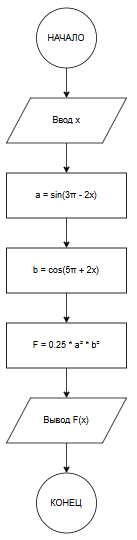

# Домашнее задание к работе 5

## Условие задачи
**Вычислить значение функции F(x), заданной формулой с тригонометрическими функциями. Программа должна принимать значение аргумента x и вычислять результат по формуле: F = 0.25 · sin²(3π - 2x) · cos²(5π + 2x)**

---

## 1. Алгоритм и блок-схема

### Алгоритм

1. **Начало**
2. **Ввод данных:**
   - Считать значение аргумента x
3. **Вычисление промежуточных значений:**
   - Вычислить a = sin(3π - 2x)
   - Вычислить b = cos(5π + 2x)
4. **Вычисление результата:**
   - Вычислить F = 0.25 · a² · b²
5. **Вывод результата:**
   - Вывести значение F(x) в экспоненциальном формате
6. **Конец**

### Блок-схема
 
## 2. Реализация программы

```c
#include <stdio.h>
#include <math.h>

int TaskDZ() {
    double x;
    
    printf("Введите значение х: ");
    scanf("%lf", &x);
    
    double a = sin(3 * M_PI - 2 * x);
    double b = cos(5 * M_PI + 2 * x);
    double F = 0.25 * a * a * b * b;
    
    printf("  F(%.2f) = %.1e\n", x, F);
    
    return 0;
}
```
## 3. Результаты работы программы
Введите значение х: 12
  F(12,00) = 3,7e-02
## 4. Информация о разработчике
Тухватулин Евгений Романович, бТИИ-261
